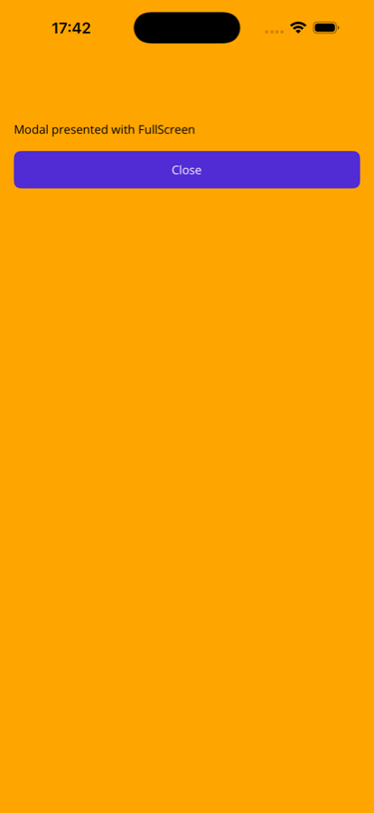
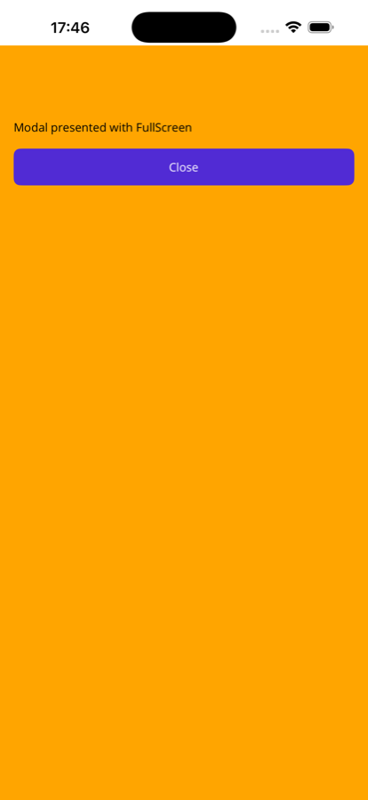
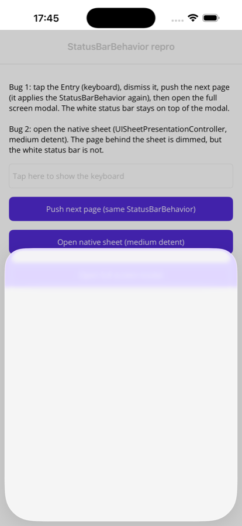

# CommunityToolkit.Maui StatusBarBehavior on iOS: repro

Minimal .NET MAUI app (iOS only) that reproduces two problems with `StatusBarBehavior` / `StatusBar` on iOS.

- .NET MAUI 10.0.90
- CommunityToolkit.Maui 15.0.1
- iOS 26.5 simulator (iPhone 17 Pro Max)

The page uses a white `StatusBarBehavior`, as many apps with a white toolbar do.

## Bug 1: status bar painted on system windows

`StatusBar` adds the colored view (tag `38482`) to every window in `UIApplication.SharedApplication.Windows`. Once a text input gets focus, iOS creates a `UITextEffectsWindow` (window level 1, above the app). The next time the color is applied, that window gets the colored view too, and it stays on top of everything.

1. Tap the Entry.
2. Tap **Push next page** (applies the `StatusBarBehavior` again).
3. Tap **Open full screen modal**.

| Without focusing the Entry | After focusing the Entry |
| --- | --- |
|  |  |

The white status bar stays on top of the orange full screen modal.

## Bug 2: native sheets don't dim the status bar

The colored view is a direct subview of the window. With `UISheetPresentationController` the presenting content is dimmed, but the status bar view is outside that hierarchy and keeps its full color.

1. Tap **Open native sheet (medium detent)**.



## Run

```
dotnet build -f net10.0-ios -t:Run
```
